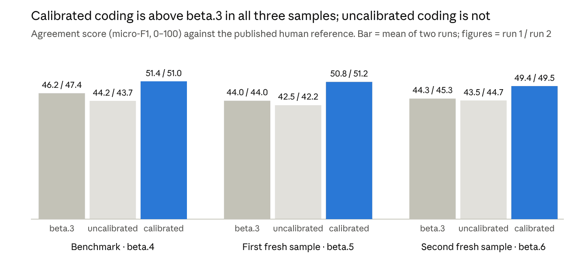
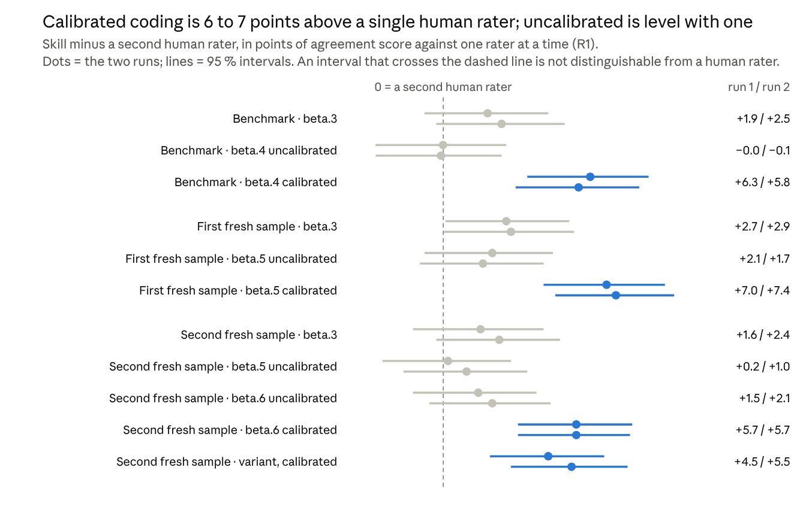
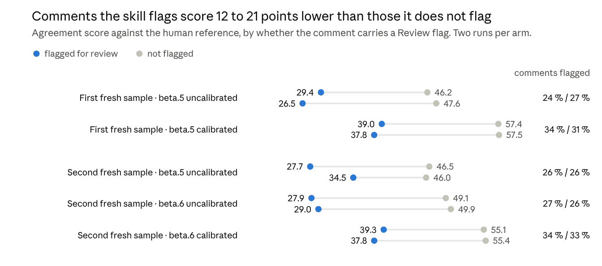

# Content Analysis Skill 5.0.0-beta.6: Test Report

*How far the skill's coding agrees with human coding. Three pre-registered tests of versions beta.3 to beta.6, with and without calibration, on 1,500 short Reddit comments from the GoEmotions corpus (27 emotion codes plus neutral), coded with `claude-opus-5-5`.*

*The protocol's two other data sets, interview transcripts and Dutch policy reports, have so far been run only under beta.3. They have their own reports from September 2026 and are not part of these results.*

13 November 2026 · Peter Malmkjær

> **Written with an AI assistant.** This report was drafted by an AI assistant (Claude) at the author's direction and from the project's result files. It may contain errors, including plausible-looking ones. The section [What was checked for this report](#what-was-checked-for-this-report) lists what was verified and what was not. Check a figure against the files in [`benchmarks/`](benchmarks/README.md) before relying on it.
>
> This file is a copy, made on 13 November 2026, of a working document. How it fits with the rest of the documentation is described in [`README.md`](README.md).

## Conclusion

The Content Analysis skill can be used as a pre-coder or as a supplementary coder. It cannot stand alone. Its coding is input for further work by a researcher, not a finished result.

**Status: experimental software.** The skill is a preview release. The results below come from one corpus and one model and are provisional. Any use on research material also requires strict compliance with the ethical and legal rules that apply to the project, which the skill does not check. These include any local rules at the user's own research institution, which this report can point to but not specify. Both points are set out under [Conditions of use](#conditions-of-use-experimental-software-and-research-ethics).

Three findings carry that conclusion. All were measured on one public corpus (GoEmotions) with one AI model, in three pre-registered tests and one pre-planned re-analysis.

| Finding | What was measured | What it means for use |
| --- | --- | --- |
| The absolute level of agreement is low | Agreement score 42–51 of 100 against the human reference. Mean Cohen's κ per code 0.26–0.44 depending on the yardstick, and at most 5 of 27 codes reach 0.667 | The coding cannot be reported as reliable on its own |
| The skill is at or above the level of one human rater | Calibrated: 6–7 points above a single crowd rater in every sample and run. Uncalibrated: not distinguishable from one, never below outside sampling error | It is good enough to do the first pass or to act as a second coder |
| The skill marks its own weak decisions | Comments carrying a `Review` flag score 27–39; unflagged comments 46–58 | A person can spend review time where the coding is weakest |

*Table 1. The three findings behind the conclusion.*

Calibration against human-coded material is what separates the two levels. With it, the skill scored 3.5 to 7.2 points above the earlier version 5.0.0-beta.3 in all six runs. Without it, the skill is not better than that earlier version.

The human work therefore does not disappear. It moves from coding every unit to three tasks: coding a calibration set, reviewing the flagged assignments, and validating a sample before anything is published.

Two further questions are treated more tentatively. Earlier in a project the skill may serve as [inspiration when a codebook is developed inductively](#as-inspiration-in-the-inductive-phase); that use was not tested. And there may be [reasons other than quality](#other-reasons-to-use-the-skill-a-tentative-assessment) to use it, such as speed, cost and scale; the tests support these only in part.

## What was tested

The object of the tests is the coding step of the skill: given a codebook and a set of text units, how far do the codes the skill assigns coincide with the codes human raters assigned to the same units. Nothing else the skill does (building a codebook, sampling, reporting) was tested here.

### Skill versions

Four released versions and one unreleased variant were compared. Table 2 lists them.

| Version | What it changed | Role in the tests |
| --- | --- | --- |
| 5.0.0-beta.3 | Earlier release, codes from the code definitions | Baseline in every test |
| 5.0.0-beta.4 | Decision rules per code, calibration against human coding, eight-step decision procedure, `Review` flag | Tested with and without calibration |
| 5.0.0-beta.5 | Two procedures: eight steps for a calibrated codebook, a simple one for an uncalibrated codebook | Tested on new comments |
| 5.0.0-beta.6 | A residual category defined by a threshold is applied before a flagged substantive code is assigned | Tested on new comments; the current version |
| Variant (not released) | Calibrated codebook coded with a four-step procedure | Used once, to isolate what the eight steps add |

*Table 2. Skill versions in the tests.*

### Material

The corpus is GoEmotions (Demszky et al., 2020): short English Reddit comments, shown without their thread, coded with 27 emotions plus `neutral`, several codes allowed per comment. Each comment in the study carries two to five usable ratings from crowd raters, three for two thirds of the comments and five for a quarter. The published reference label is what at least two of them agreed on.

Three disjoint samples of 500 comments were drawn at random with fixed seeds from the official test split. A further 400 comments were used to calibrate the codebook and 200 to re-test the calibration's revisions. No test comment was part of the calibration.

| Sample | Comments | Reference labels | Used for |
| --- | --: | --: | --- |
| Benchmark | 500 | 579 | beta.3 against beta.4 |
| First fresh sample | 500 | 597 | beta.5 |
| Second fresh sample | 500 | 577 | beta.6 and the variant |
| Calibration | 400 | n/a | Calibrating the codebook |
| Re-test | 200 | n/a | Keeping or reverting each revision |

*Table 3. Samples.*

The dataset is public, in the [original GoEmotions release](https://github.com/google-research/google-research/tree/master/goemotions) and as a [Hugging Face dataset](https://huggingface.co/datasets/google-research-datasets/go_emotions). The ids and human labels of all 2,100 comments used here, marked by sample, are in [`units.csv`](https://github.com/PeterMalmkjaer/content-analysis-plugin/blob/main/docs/benchmarks/results/units.csv). The seeds and the drawn ids of each sample are in [`splits.json`](https://github.com/PeterMalmkjaer/content-analysis-plugin/blob/main/docs/benchmarks/protocol/splits.json), [`splits_addendum.json`](https://github.com/PeterMalmkjaer/content-analysis-plugin/blob/main/docs/benchmarks/protocol/splits_addendum.json) and [`splits_addendum2.json`](https://github.com/PeterMalmkjaer/content-analysis-plugin/blob/main/docs/benchmarks/protocol/splits_addendum2.json). The full list of links is in [Table 17](#where-the-materials-are).

### Two conditions

**Calibrated** means the skill first drafted decision rules for each code, coded the 400 human-coded calibration comments with them, and reviewed the disagreements. The reviewer revised the decision-rule entries of 15 of the 28 codes. Each revision was then tested on the 200 re-test comments by a rule fixed in advance: 12 were kept and 3 reverted. On the re-test comments the agreement score rose from 42.7 to 49.2.

**Uncalibrated** means the skill coded from the original 28-line codebook with no human-coded material.

### The two data sets that were not run for these versions

The pre-registered protocol names three data sets. Only the third, GoEmotions, was run for beta.4 to beta.6. The order was fixed in advance: GoEmotions first, and the other two only on a decision taken after its cost was known. That decision has not been taken, so the two are reported here as not run.

**Set 1: interview transcripts.** Seven semi-structured interviews on open research data, held at TU Delft in 2020 with policy makers, support staff and researchers (Zuiderwijk-van Eijk & van Gend, 2022). They are divided into 262 question-and-answer units and coded deductively with the authors' own codebook of 54 codes. The reference is the published coding by one researcher. This is the material closest to what the skill is mainly meant for.

**Set 2: policy reports.** 184 recommendation excerpts from six Dutch advisory reports on government ICT projects (Janssens, Bharosa & Janssen, 2026), coded on five fields, the first of which decides whether an excerpt concerns governance at all. The reference is the authors' own AI-assisted workflow with researcher review. It is not independent human coding, so a result on this set would be agreement with that workflow and not agreement with people.

**What exists for these two sets concerns beta.3 only,** and comes from two sources of different standing.

The first is an external evaluation of 9 September 2026, run in another product on another model family, with its own protocol. It has its own reports, in Danish: one per data set and a summary. They are published in the repository under [`docs/evaluations/2026-09-beta3-external/`](https://github.com/PeterMalmkjaer/content-analysis-plugin/tree/main/docs/evaluations/2026-09-beta3-external). The reports were written by an AI, and each carries a notice saying so and warning that it may contain errors. Their headline figures were recomputed from the evaluation's coded data before publication and match. The README of that folder states what the check covers and what it does not; for the interviews it is partly circular, because the reference was rebuilt from the evaluation's own output files. The main figures are these.

On the interviews, all 262 units: agreement score 60.1, precision 64.6, recall 56.1, macro-F1 57.9, identical code set in 26.3 % of the units, and a mean κ per code of 0.565. The score depends on how the researchers' coded passages are mapped to units and falls to 53.0 under a stricter mapping. A blind repeat of one interview agreed with the first run at 83.4. The interview figures were reproduced in this project from that evaluation's output files.

On the policy reports, all 184 excerpts: agreement with the reference workflow 63.1, precision 58.6, recall 68.3, and all five fields identical in 40.2 % of the excerpts. Of the 85 excerpts the reference treats as not governance-relevant, 34 were coded as relevant. A blind repeat of one report agreed with the first run at 87.5.

Those reports reach a verdict close to the one here: the output is usable as a verifiable draft that needs expert review, and it does not replace the researchers' judgement. The figures should not be set beside the GoEmotions figures in this report. They come from another model, another protocol, a single run and, for the policy reports, a reference that is itself an AI workflow. The evaluation also notes that it used shorter code descriptions and a smaller pilot than the skill prescribes.

The second is a single run of beta.3 on all three sets in this project, also in September 2026, on an earlier Claude model. It gave agreement scores of 60.0 on the interviews, 58.8 on the policy reports and 43.0 on GoEmotions. The coded files were lost when the workspace was reclaimed. Only the figures noted at the time remain, and they are not used in any comparison in this report.

Neither source says anything about beta.4 to beta.6. In particular, whether calibration helps on interviews is unknown. One difficulty is known in advance: in the planned calibration part of the interview set, only 3 of the 54 codes have ten or more reference cases, so a calibration there would rest on little.

## Method

The tests were designed so that a result could go against the skill and still be reported. Each test fixed its hypotheses, its sample and its rule for what counts as an improvement before any comment was coded.

### Design

| Element | How it was done |
| --- | --- |
| Pre-registration | A protocol and two addenda, each frozen by a SHA-256 hash before coding started. A separate plan was frozen before the comparison with individual raters |
| Coding model | `claude-opus-5-5` in every arm, read from the harness transcripts and not self-reported |
| Isolation | One separate AI context per batch of 50 comments. Each received only the skill text, the codebook and the batch |
| Blindness | No coder saw human labels. Every file each coder opened was checked afterwards against the list it was allowed |
| Runs | Two independent runs per arm. Within a run, all arms code the same batches |
| One shot | Each new skill text was frozen before its test and tested once, on comments not used before |
| Recomputation | Every headline figure was computed by three scripts written separately; they agree |

*Table 4. Design of the tests.*

### Measures

The main measure is **micro-F1** on a scale from 0 to 100, called the agreement score in this report. It counts how far the skill's code assignments coincide with the human ones, penalising both codes the skill assigned that the humans did not and codes the humans assigned that the skill missed. A score of 100 would be identical coding.

Three further measures are reported where they matter. **Macro-F1** is the average over codes, so that rare codes weigh as much as frequent ones. **Cohen's κ** per code is agreement corrected for chance, the measure that the conventional reliability thresholds refer to. **Run-to-run F1** is the agreement between the skill's own two runs, a measure of stability.

### Decision rule

A difference between two arms was tested with a paired bootstrap: 2,000 resamples of the 500 comments, 95 % interval. An improvement is claimed only where the interval excludes zero in both runs. A difference in the right direction without that is called *direction only*.

This rule rests on three assumptions. The comments are treated as independent draws from the corpus. The human reference is treated as fixed. And the interval covers sampling of comments only: variation between model versions, prompts and codebooks is not in it.

### Two yardsticks

The skill was compared with human coding in two ways, and the difference between them matters for the conclusion.

The first yardstick is the **published reference**: the labels at least two raters agreed on. This is the stricter test, because the aggregate is more stable than any one rater.

The second is the **individual rater**. Here the question is whether the skill agrees with a human rater as well as a second human rater does. It was answered in two forms: against one rater at a time (R1), and against the majority of the other raters on a comment (R2). In R2, 32–35 % of the cases drop out because the remaining raters do not form a majority.

## Result 1: calibration is what raises agreement

With calibration the skill agrees better with the human reference than version beta.3 does, in all six runs. Without calibration it does not. Figure 1 shows the levels; Table 5 gives the tested differences.

*Figure 1. Agreement score (micro-F1, 0–100) against the published human reference. Bar = mean of two runs. Source: results\_set3.json, results\_set3\_fresh.json, results\_set3\_fresh2.json · 3 disjoint samples of 500 comments, 2 runs per arm.*

| Sample | Version tested | beta.3 (run 1 / run 2) | Uncalibrated (run 1 / run 2) | Calibrated (run 1 / run 2) |
| --- | --- | --- | --- | --- |
| Benchmark | beta.4 | 46.2 / 47.4 | 44.2 / 43.7 | 51.4 / 51.0 |
| First fresh sample | beta.5 | 44.0 / 44.0 | 42.5 / 42.2 | 50.8 / 51.2 |
| Second fresh sample | beta.6 | 44.3 / 45.3 | 43.5 / 44.7 | 49.4 / 49.5 |

*Data behind Figure 1.*

The three samples are not comparable with each other in level. The baseline alone differs by about three points between them, which is the scale against which the differences should be read. Comparisons hold within a sample.

| Sample | Comparison | Run 1 | Run 2 | Verdict |
| --- | --- | --- | --- | --- |
| Benchmark | beta.4 calibrated − beta.3 | +5.2 \[+2.2, +8.2\] | +3.5 \[+0.7, +6.6\] | Improvement |
| Benchmark | beta.4 uncalibrated − beta.3 | −2.0 \[−4.3, +0.2\] | −3.7 \[−6.2, −1.3\] | Below in one run of two |
| First fresh | beta.5 calibrated − beta.3 | +6.8 \[+3.9, +9.7\] | +7.2 \[+4.1, +10.5\] | Improvement |
| First fresh | beta.5 uncalibrated − beta.3 | −1.5 \[−3.5, +0.7\] | −1.8 \[−4.0, +0.2\] | Not distinguishable |
| Second fresh | beta.6 calibrated − beta.3 | +5.2 \[+2.2, +8.1\] | +4.2 \[+1.1, +7.2\] | Improvement |
| Second fresh | beta.6 uncalibrated − beta.3 | −0.7 \[−2.5, +1.1\] | −0.6 \[−2.5, +1.2\] | Not distinguishable |
| Second fresh | beta.5 uncalibrated − beta.3 | −2.2 \[−4.2, −0.3\] | −2.1 \[−4.0, −0.2\] | Below |
| Second fresh | beta.6 uncalibrated − beta.5 uncalibrated | +1.5 \[−0.5, +3.4\] | +1.5 \[−0.2, +3.1\] | Direction only |

*Table 5. Differences in agreement score, with 95 % bootstrap intervals.*

### What the differences say

**Calibrated.** The gain over beta.3 is between 3.5 and 7.2 points, and its interval excludes zero in every one of the six runs. The finding was made on the benchmark and then repeated twice on comments that had played no part in anything before.

**Uncalibrated.** No uncalibrated version scored above beta.3 in any run. beta.4 and beta.5 were below it, outside sampling error in three of six runs. beta.6 closed most of that gap and is no longer distinguishable from beta.3, but the step from beta.5 to beta.6 is itself direction only.

### Rare codes and stability

The gain is in the frequent codes. Macro-F1, where every code weighs the same, rose under calibration in the first fresh sample (46 against 42) but not in the benchmark (about 40 in every arm) and not in the second fresh sample (+0.1 and −4.5). A gain in rare codes is not established.

The skill does not give exactly the same coding twice. Agreement between its own two runs was 85–92 on the same scale, and in the first fresh sample 79–85 % of comments received an identical set of codes in both runs. The calibrated path was the most stable in every sample.

## Result 2: at or above the level of a single human rater

Measured against one human rater at a time, the calibrated skill agrees with that rater better than a second human rater does. The uncalibrated skill agrees about as well as a second human rater. No arm was below the human level outside sampling error; the lowest, beta.4 uncalibrated, sits on it. Figure 2 shows the difference for every arm.

*Figure 2. Skill minus a second human rater, in points of agreement score against one rater at a time (R1), with 95 % intervals. Source: results\_raters.json · 3 samples of 500 comments, 5,299 individual ratings, 11 arms, 2 runs each.*

| Sample | Arm | Run 1 | Run 2 |
| --- | --- | --- | --- |
| Benchmark | beta.3 | +1.9 [−0.8, +4.5] | +2.5 [−0.3, +5.2] |
| Benchmark | beta.4 uncalibrated | −0.0 [−2.9, +2.7] | −0.1 [−2.9, +2.5] |
| Benchmark | beta.4 calibrated | +6.3 [+3.6, +8.8] | +5.8 [+3.1, +8.4] |
| First fresh | beta.3 | +2.7 [+0.1, +5.4] | +2.9 [+0.0, +5.6] |
| First fresh | beta.5 uncalibrated | +2.1 [−0.8, +4.7] | +1.7 [−1.0, +4.3] |
| First fresh | beta.5 calibrated | +7.0 [+4.3, +9.5] | +7.4 [+4.8, +9.9] |
| Second fresh | beta.3 | +1.6 [−1.3, +4.3] | +2.4 [−0.3, +5.0] |
| Second fresh | beta.5 uncalibrated | +0.2 [−2.6, +2.9] | +1.0 [−1.7, +3.6] |
| Second fresh | beta.6 uncalibrated | +1.5 [−1.3, +4.0] | +2.1 [−0.6, +4.6] |
| Second fresh | beta.6 calibrated | +5.7 [+3.2, +8.1] | +5.7 [+3.2, +8.0] |
| Second fresh | Variant, calibrated | +4.5 [+2.0, +6.9] | +5.5 [+2.9, +7.9] |

*Data behind Figure 2.*

The human level that the zero line stands for is itself low: two raters of the same comment reach an agreement score of 35.2, 32.3 and 34.1 with each other in the three samples. The skill's level on the same measure is 34–42.

One result in Figure 2 needs a caution. beta.3 on the first fresh sample counts as above a human rater by the rule, but its intervals start at +0.1 and +0.0. That is a borderline reading, and it did not repeat in the other two samples.

### Against the majority of the other raters

The second form of the comparison (R2) holds one rater out and asks who agrees better with the majority of the remaining raters: the held-out human, or the skill. Table 6 gives the result.

| Sample | Arm | Run 1 | Run 2 | Reading |
| --- | --- | --- | --- | --- |
| Benchmark | beta.3 | +5.0 \[+0.1, +9.8\] | +7.0 \[+2.2, +11.7\] | Above |
| Benchmark | beta.4 uncalibrated | +2.4 \[−2.5, +7.4\] | +1.5 \[−3.4, +6.6\] | Not distinguishable |
| Benchmark | beta.4 calibrated | +10.8 \[+6.3, +15.2\] | +8.6 \[+3.8, +13.2\] | Above |
| First fresh | beta.3 | +9.1 \[+4.2, +14.3\] | +9.6 \[+4.7, +14.9\] | Above |
| First fresh | beta.5 uncalibrated | +8.4 \[+3.5, +13.6\] | +8.0 \[+3.2, +13.1\] | Above |
| First fresh | beta.5 calibrated | +15.7 \[+10.5, +20.7\] | +15.9 \[+11.0, +21.1\] | Above |
| Second fresh | beta.3 | +2.0 \[−2.7, +7.0\] | +4.1 \[−0.7, +9.0\] | Not distinguishable |
| Second fresh | beta.5 uncalibrated | +0.4 \[−4.4, +5.3\] | +1.9 \[−2.7, +6.7\] | Not distinguishable |
| Second fresh | beta.6 uncalibrated | +1.3 \[−3.6, +6.1\] | +2.6 \[−2.2, +7.6\] | Not distinguishable |
| Second fresh | beta.6 calibrated | +7.3 \[+2.7, +11.9\] | +7.2 \[+2.5, +11.8\] | Above |
| Second fresh | Variant, calibrated | +5.9 \[+1.0, +10.6\] | +7.1 \[+2.5, +11.8\] | Above |

*Table 6. Skill minus held-out human rater, agreement score against the majority of the other raters (R2), with 95 % intervals. Human level: 42.2, 35.3 and 41.4.*

The calibrated arms are above the held-out human everywhere, by 7 to 16 points. The arms without calibration are mixed: beta.3 is above in the first two samples and beta.5 in the first fresh sample, while beta.4 uncalibrated and all three such arms in the second fresh sample are not distinguishable. Keeping the cases where the other raters form no majority, instead of dropping them, changes no reading.

### Chance-corrected agreement

Mean Cohen's κ per code tells the same story at a lower level. Against one rater the skill reaches 0.26–0.30 and a second human 0.24–0.25. Against the majority of the other raters the skill reaches 0.33–0.43 and the held-out human 0.26–0.31.

### What this comparison can and cannot carry

It shows that the skill is not a worse coder than one of the people who produced the reference. That is the basis for using it as a first or second coder.

It does not show that the skill is reliable. Being better than a single crowd rater whose agreement with a colleague is κ 0.24 is a low bar. The raters were crowd workers reading comments without context, not trained coders working with a codebook they had discussed. How the skill compares with trained coders has not been measured.

Three technical points qualify the comparison. The plan for it was frozen before the rater-level data were obtained, but only five of the eleven arms were named in that plan; the other six were added afterwards with the same rule. The calibrated codebook was tuned towards the majority labels of this corpus, which favours the calibrated arms in R2. And 88 ratings without any label, on 70 of the 1,500 comments, were treated as "very unclear" and left out, an inference from the dataset documentation that could not be checked against the original files.

## Result 3: the Review flag points at the weaker coding

From beta.4 on, the skill marks an assignment with a `Review` flag when the decision was hard. In every arm and every run, the flagged comments agree far less with the human reference than the unflagged ones. This is the property that makes the skill usable as a pre-coder: it tells the researcher where to look first. Figure 3 shows the gap.

*Figure 3. Agreement score against the human reference, by whether the comment carries a Review flag. Source: results\_set3\_fresh.json, results\_set3\_fresh2.json · 2 samples of 500 comments, 5 arms, 2 runs each.*

| Sample | Arm | Flagged (run 1 / run 2) | Not flagged (run 1 / run 2) | Comments flagged (run 1 / run 2) |
| --- | --- | --- | --- | --- |
| First fresh | beta.5 uncalibrated | 29.4 / 26.5 | 46.2 / 47.6 | 24 % / 27 % |
| First fresh | beta.5 calibrated | 39.0 / 37.8 | 57.4 / 57.5 | 34 % / 31 % |
| Second fresh | beta.5 uncalibrated | 27.7 / 34.5 | 46.5 / 46.0 | 26 % / 26 % |
| Second fresh | beta.6 uncalibrated | 27.9 / 29.0 | 49.1 / 49.9 | 27 % / 26 % |
| Second fresh | beta.6 calibrated | 39.3 / 37.8 | 55.1 / 55.4 | 34 % / 33 % |

*Data behind Figure 3.*

### What is flagged

The flag has four kinds: `competing_codes`, `possible_irony`, `context_missing` and `insufficient_basis`. Under calibration, 59–73 % of the flags are `competing_codes`: the skill found two codes that both fit and chose one. Without calibration the flags are spread more evenly over the kinds.

The review load that follows is a quarter of the comments without calibration and a third with calibration. Calibration makes the skill flag more, not less.

### What the flag does not do

**It is not a quality guarantee for the rest.** Unflagged comments score 46–58. That is better than the flagged ones and still far from a level that could be accepted without checking. Reviewing only the flagged comments leaves most of the disagreement in place.

**It marks hard comments, not only skill errors.** Scored on the same comments, beta.3 also does worse where a later version raised a flag (28–40 against 46–50). The flagged comments are harder for any coder, and it is plausible that the human raters were also less agreed on them. That last point is an inference; it was not measured.

**Its effect on a final result has not been tested.** No person reviewed the flagged comments in these tests. Whether a human pass over the flagged quarter or third would lift agreement, and by how much, is unknown.

## Result 4: uneven across codes, and biased without calibration

The overall score hides large differences between codes. Some codes are coded well in every sample, some poorly in every sample, and calibration moves individual codes in both directions. A researcher whose argument rests on particular codes has to look at those codes, not at the overall figure.

### Agreement per code

Table 7 gives the agreement score for nine codes in the three samples, each cell showing beta.3 and then the calibrated version (mean of two runs).

| Code | Benchmark | First fresh | Second fresh | Pattern |
| --- | --- | --- | --- | --- |
| gratitude | 82 → 82 | 88 → 89 | 82 → 83 | High, unchanged |
| amusement | 58 → 75 | 52 → 82 | 42 → 66 | Large gain in all three |
| curiosity | 40 → 52 | 41 → 52 | 54 → 59 | Gain in all three |
| admiration | 47 → 56 | 55 → 62 | 62 → 65 | Gain in all three |
| neutral | 56 → 62 | 46 → 56 | 54 → 61 | Gain in all three |
| approval | 31 → 35 | 31 → 43 | 36 → 31 | Low, mixed |
| disapproval | 27 → 15 | 22 → 26 | 19 → 21 | Low, mixed |
| annoyance | 31 → 29 | 27 → 26 | 27 → 22 | Low, slightly worse in all three |
| caring | 38 → 26 | 44 → 30 | 48 → 48 | Worse in two, unchanged in one |

*Table 7. Agreement score per code, beta.3 → calibrated. Source: per-code results of the three tests.*

Among the codes with at least ten human-assigned cases, calibration raised the score for 11 of 16 in the benchmark, 14 of 20 in the first fresh sample and 12 of 18 in the second. It lowered it for 4, 6 and 6. A code with about twenty cases moves several points from one sample to the next by chance alone, so a single cell in Table 7 shows direction at most.

### The weak codes are the ones people disagree on

The codes where the skill scores lowest are the codes where the human raters agree least with each other. Demszky et al. (2020, Table 7) report Cohen's κ between two raters of 0.75 for gratitude and 0.47 for admiration, against 0.23 for disapproval, 0.19 for annoyance, 0.19 for approval, 0.18 for disappointment and 0.16 for realization. Where two people agree that little, no coder can agree much with their aggregate. Part of the low level is therefore a property of the reference and not of the skill. How large that part is cannot be told from these data.

### A systematic bias in how often codes are assigned

Without calibration, every version assigns `disapproval` three to five times as often as the human raters and `neutral` only half to four fifths as often. Calibration removes both. Table 8 gives the counts.

| Code | Coder | Benchmark | First fresh | Second fresh |
| --- | --- | --: | --: | --: |
| neutral | Human reference | 178 | 147 | 158 |
| neutral | beta.3 | 144 | 95 | 102 |
| neutral | Uncalibrated (beta.4, beta.5, beta.6) | 115 | 77 | 114 |
| neutral | Calibrated | 179 | 147 | 166 |
| disapproval | Human reference | 25 | 22 | 17 |
| disapproval | beta.3 | 83 | 77 | 71 |
| disapproval | Uncalibrated (beta.4, beta.5, beta.6) | 123 | 95 | 72 |
| disapproval | Calibrated | 29 | 28 | 30 |

*Table 8. Number of comments assigned the code (mean of two runs, rounded).*

The practical consequence is that frequency counts from uncalibrated coding are distorted for at least these two codes. A finding of the type "a fifth of the comments express disapproval" would be an artefact of the coder. The table does not say who is right about any single comment: the human raters read the comments without their thread, and a different convention for what counts as disapproval is not an error in itself. It says that the skill and the human raters apply different thresholds until the skill is calibrated to theirs.

### The residual-category rule in beta.6

beta.5 told the skill never to use a residual category as a way out of a hard decision. In a codebook where the residual category is defined as "no sufficiently clear emotion", that instruction works against the codebook. beta.6 puts the codebook's own threshold first.

On the second fresh sample the effect was as intended in direction: uncalibrated `neutral` assignments rose from 86 to 114 and `disapproval` fell from 84 to 72, and the agreement score rose by 1.5 points in both runs. The intervals for that gain include zero, so it counts as direction only. The rule has been tested on one codebook with one residual category.

## Result 5: the calibrated codebook does most of the work

The calibrated path differs from beta.3 in two things at once: the codebook carries decision rules tested against human coding, and the skill codes with an eight-step decision procedure. The second fresh sample included an unreleased variant to separate the two: the same calibrated codebook, coded with a short four-step procedure.

| Comparison | Run 1 | Run 2 | Reading |
| --- | --- | --- | --- |
| Variant (calibrated codebook, four steps) − beta.3 | +3.2 \[+0.3, +6.4\] | +3.7 \[+0.8, +6.7\] | The codebook alone gives a gain |
| beta.6 calibrated (eight steps) − variant | +2.0 \[+0.3, +3.6\] | +0.4 \[−1.0, +1.9\] | Not established: one run of two |
| beta.6 calibrated − beta.3 | +5.2 \[+2.2, +8.1\] | +4.2 \[+1.1, +7.2\] | Improvement |

*Table 9. What the eight-step procedure adds on top of a calibrated codebook (second fresh sample).*

Three to four of the four to five points come with the calibrated codebook alone. The eight steps add between nothing measurable and two points. By the rule of the tests that is not an established contribution.

The other measures do not separate the two procedures either. Both are above a single human rater (Figure 2). Their run-to-run stability is the same (90.2 and 90.3). The variant flags slightly more assignments (32 % against 28–30 %). And the short procedure was not cheaper in tokens or time, contrary to what was expected beforehand; that wrong expectation is logged in the deviation file.

The procedure was nevertheless left unchanged in beta.6. It was designed for long interview answers, where several codes compete within one unit and where low recall was the problem reported for beta.3. It has not been tested on such material. One sample of short comments is not enough evidence to remove it, and not enough to claim that it helps.

### The same procedure without calibration

The clearest negative finding in the tests concerns the eight steps without a calibrated codebook. In beta.4 the skill drafted decision rules from the code definitions alone and then applied the full procedure. That arm scored 2.0 and 3.7 points below beta.3, outside sampling error in the second run, and it assigned `disapproval` to 123 of 500 comments where the human raters assigned it to 25. Rules that no human coding has checked can widen a code. This is why beta.5 and beta.6 write no decision rules of their own when there is nothing to calibrate against.

## Effort and cost

The machine side of the work is cheap and was measured. The human side was not measured, and it does not disappear: the calibrated path depends on human-coded material, and the skill's output needs review.

### Measured: the skill

| Item | beta.3 | beta.6 without calibration | beta.6 with calibration |
| --- | --- | --- | --- |
| Median time per batch of 50 comments | 25 s | 31–34 s | 48 s |
| Cost per 1,000 comments coded | about \$7.60 | about \$8.50–8.60 | about \$10.80 |
| One-off calibration | none | none | about \$16 and 15 minutes of machine time |

*Table 10. Measured machine effort on `claude-opus-5-5`.*

Coding therefore costs about one cent per comment. The calibration cost is made up of the rule drafter (\$0.95), the calibration reviewer (\$6.33) and the coding of the 600 calibration and re-test comments (about \$8.60). The three test rounds together cost about \$118 in model use (\$44, \$27 and \$47), not counting the session that orchestrated them.

These dollar figures rest on the list price of \$4 and \$20 per million input and output tokens, checked on 12 November 2026, and on cache multipliers of 1.25 for writes and 0.1 for reads. The multipliers are an assumption that was not checked; the provider's current price list would settle it. Token counts and times are measured.

### Not measured: the people

No human coding time was recorded in these tests, because the human coding already existed. Any statement about saved human effort is therefore a calculation from assumptions and not a finding.

Table 11 is such a calculation, for a corpus of 5,000 short comments. It assumes 30 seconds per comment both for coding and for reviewing a flagged assignment, a calibration set of 600 comments as in the tests, a third of the comments flagged, and a validation sample of 300 comments coded by two people.

| Task | Conventional double coding | Skill as pre-coder |
| --- | --: | --: |
| Coding all 5,000 comments, two coders | 83 h | n/a |
| Coding the calibration set (600), two coders | n/a | 10 h |
| Reviewing the flagged third (about 1,650) | n/a | 14 h |
| Validation sample (300), two coders | n/a | 5 h |
| **Total human time** | **83 h** | **29 h** |

*Table 11. Illustration under the stated assumptions. Not a measurement.*

Three things follow from the calculation if its assumptions are roughly right. Human effort is considerably larger for conventional coding, as expected. The saving comes from not coding the bulk, not from removing people. And the saving shrinks with the corpus: the calibration set and the validation sample are fixed costs, so for a corpus of about a thousand units the two routes cost about the same human time.

Whether 600 calibration comments are needed, or fewer would do, has not been tested. Neither has the time a reviewer actually needs per flagged assignment. A small timed pilot on the user's own material would replace both assumptions with figures.

## Other reasons to use the skill: a tentative assessment

Quality of coding is not the only reason someone might use the skill. It may be cheaper, faster, or the only practical way to handle a large body of text. This section looks at how far the tests support such reasons. It is deliberately not conclusive. Only machine time and machine cost were measured, on one corpus of short comments, and everything about human effort is calculated from assumptions.

| Reason | What the tests indicate | What remains open |
| --- | --- | --- |
| Speed of the coding itself | Measured at about 0.6–1.0 second per comment (Table 10). This seems robust: it would hold even if a human coder were several times faster than assumed | Longer texts. Coding thousands of units in one ordinary session, which is not how the tests ran |
| Time to a usable result | Probably shorter for large corpora, by calculation only (Table 11) | The human time for calibration, review and validation was not measured. For small corpora there may be no gain |
| Cost of the coding itself | Measured at about one cent per comment | Rests on an assumed cache price. Longer texts will cost more per unit, by a factor that is not known |
| Total cost | May be lower from roughly a thousand units upwards, under the assumptions of Table 11 | Not measured. Depends on what a reviewer's time costs and on how much review the purpose requires |
| Handling a large corpus | Coding 50,000 comments would cost roughly \$425–540 in model use at the measured rate, which looks affordable | Whether the result is usable. Reviewing a flagged third stops being feasible at that size, and errors that are systematic do not shrink with volume |
| Recoding after a codebook change | Cheap in machine terms, which may make revising a codebook less costly than with human coders | Not tested. Changed codes would presumably need calibrating again |
| No second coder available | The skill agreed with a rater about as well as a second crowd rater did (Result 2) | Not compared with trained coders. Not shown to be a substitute for a second person in a reliability check |
| Consistency | Two runs agreed at 85–92, so the skill is fairly but not fully consistent with itself | Not compared with how consistent a human coder is with themselves. Behaviour over very long runs was not tested |

*Table 12. Reasons other than coding quality: what the tests indicate and what they leave open.*

### Three cautions

**Volume does not correct systematic error.** Random disagreement tends to even out in large numbers. A coder that leans one way does not. Without calibration the skill assigned `disapproval` three to five times as often as the human raters, and there is no reason to expect that lean to be smaller in a larger corpus. More data would make such an estimate more precise without making it more right.

**A low price says nothing about the value of what is bought.** The saving in Table 11 is the saving from not coding the bulk by hand while still calibrating, reviewing and validating. A cheaper route that skips those steps has not been shown to produce coding that can be used.

**Scale may call for a different design.** With a very large corpus, one possibility is to treat the skill's coding as an imperfect measurement, hand-code a random sample, and use that sample to correct estimates for the whole corpus and to state their uncertainty. Angelopoulos et al. (2023) describe a general framework of this kind, in which machine predictions are combined with a small gold-standard sample to give valid confidence intervals. Whether it suits coded text of this kind, with many codes and a reference that is itself uncertain, has not been examined here. The skill does not implement it.

### What others have found

Gilardi et al. (2023) report a cost below \$0.003 per annotation for a language model on tweets and news articles, about thirty times cheaper than crowd workers, with accuracy above that of the crowd workers. This points in the same direction as the cost figures here. It is a single study of another model, other tasks and other categories, so it lends some support to the direction and none to the numbers.

### Where this leaves the question

Speed and machine cost look like sound reasons to use the skill for a first coding, and scale looks like a reason to consider it. None of them appears to change the conclusion of this report. They seem to bear on whether a pre-coder is worth having, and not on whether its coding can stand without human work. A firmer answer would need a measured comparison: the same corpus coded both ways, with the human hours recorded.

## Assumptions

The results hold under the assumptions in Table 13. Each is stated with what depends on it and with what would test it.

| # | Assumption | What depends on it | What would test it |
| --- | --- | --- | --- |
| A1 | The human reference is a usable yardstick. It is treated as fixed and as the standard, although it is aggregated judgement and not truth | Every agreement score in the report | A reference coded by trained coders with a discussed codebook, on the same comments |
| A2 | Micro-F1 is the right headline measure. It weighs every assignment equally, so frequent codes dominate | The claim that calibration improves agreement | The macro-F1 and per-code figures, which are reported and do not all agree with the headline |
| A3 | The 500 comments in a sample are independent draws from the corpus | The bootstrap intervals | Not testable here; comments from one thread could be dependent, but they were drawn at random from 5,427 |
| A4 | Two runs per arm show the run-to-run variation | The rule "in both runs" | More runs per arm; with two, a rare unstable run cannot be ruled out |
| A5 | All arms were coded by the same model, so differences between arms are differences between skill texts and codebooks | Every comparison between versions | Already checked: the model identifier was read from the harness transcripts of every coder |
| A6 | The coders were blind to the human labels | The validity of all scores | Already checked for files and tool calls. Not checkable for training data: GoEmotions is public and the model may have seen it. That applies to every arm equally, so it threatens the levels more than the differences |
| A7 | Calibration material and the texts to be coded come from the same source | The size of the calibrated gain | Calibrating on one corpus and testing on another |
| A8 | A rating without any label is a rating the rater marked "very unclear" | The comparison with individual raters (88 ratings on 70 comments) | The original rater-level CSV files of the GoEmotions release |
| A9 | The skill behaves in ordinary use as it did in the test harness, where each batch of 50 was coded in a fresh context with a short fixed prompt | Transfer of every result to real use | A run through the Claude or ChatGPT app on the same sample |
| A10 | The reference has no errors of transcription: the labels used are the published ones | All scores | Already checked: for all 1,500 comments the labels chosen by at least two raters reproduce the published reference exactly |

*Table 13. Assumptions behind the results.*

Two of these carry more weight than the rest. A1 decides what the scores mean at all: agreement with crowd raters who themselves agree little is a weak proxy for coding quality, in both directions. A7 decides how far the calibrated gain travels: the calibrated rules encode the conventions of this corpus's raters, and a codebook calibrated on one kind of material may gain less, nothing, or lose on another.

## Limitations of the evidence

This section lists what the tests cannot support. The limitations are grouped by what they restrict: how far the results generalise, how firmly they are established, and how the tests were run.

### How far the results generalise

**One corpus, one kind of text.** Everything was measured on short English Reddit comments coded for emotion. Interviews, open survey answers, reports, policy documents, news text and Danish-language material are untested under beta.4 to beta.6. An external evaluation of beta.3 exists for interviews and reports; it has not been repeated for the later versions.

**One codebook, given in advance.** The codebook had 28 flat categories and came with the dataset. The skill's work in developing a codebook, in segmenting text into units, and in handling hierarchical or latent categories was not tested.

**One model.** All coding ran on `claude-opus-5-5`. The skill also runs in ChatGPT and Codex, where it has not been benchmarked. A later version of the same model may behave differently.

**Calibration only in-distribution.** The calibration comments came from the same corpus as the test comments, rated by the same pool of raters. The gain of 3.5 to 7.2 points is a gain under those conditions.

**One calibration round.** The codebook was calibrated once, under the beta.4 text, and reused in the later tests. The calibration procedure is unchanged in beta.5 and beta.6, but running it again was not part of those tests. Whether a second calibration from scratch gives the same gain is unknown.

### How firmly the results are established

**The reference is weak.** The human raters were crowd workers who agreed with each other at a mean κ of about 0.25. A weak reference caps the agreement any coder can reach and blurs differences between coders.

**Samples of 500.** Overall figures are stable to within a few points. Per-code figures are not: most codes have fewer than 30 human-assigned cases per sample, six to eleven codes have fewer than ten, and two (`grief`, `relief`) do not occur in every sample.

**Two runs per arm.** Enough to see that results repeat, not enough to describe the spread.

**No gain in rare codes.** Macro-F1 and mean κ per code did not rise consistently under calibration. The improvement is real for the bulk of assignments and not shown for the tail.

**The uncalibrated improvement in beta.6 is direction only.** The step from beta.5 to beta.6 was +1.5 points in both runs with intervals that include zero.

**The recommended workflow is itself untested.** No person reviewed flagged assignments or validated a sample in these tests. The report shows that the skill produces usable input for such a workflow, not that the workflow produces reliable coding.

### How the tests were run

**Developer and tester are the same.** The skill, the tests and this report come from the same project. The safeguards are pre-registration, frozen hashes, blind isolated coders, an audit of every file opened, and public result tables from which the figures can be recomputed. They reduce the risk of self-serving results; they do not replace an independent replication, which has not been done.

**Each version was written after seeing earlier results.** beta.5 and beta.6 respond to what the previous test showed. Testing each on comments not used before guards against fitting the test comments. It does not guard against fitting this corpus: the rule in beta.6 addresses a pattern seen in GoEmotions, and all three samples come from GoEmotions.

**Part of the rater comparison was added afterwards.** Six of the eleven arms in the comparison with individual raters were not named in the frozen plan. They were analysed with the same rule and are marked as added.

**The data source for the rater comparison was a secondary export.** The original rater-level files could not be fetched; a Hugging Face export of the same data was used and checked against the published reference (1,500 of 1,500 comments reproduce). One column in that export is empty, which is the reason for assumption A8.

**Corrections were needed along the way.** The first report described the second run's batches wrongly, the beta.5 documentation described the uncalibrated path as not distinguishable from beta.3 before the second sample showed it below, and two cost expectations were wrong. All are logged in the deviation files and corrected in the published reports.

## Limits of use

Where the previous section says what the evidence cannot support, this one says what the skill should not be used for. Each limit follows from a measured result.

| # | Limit | Measured reason |
| --- | --- | --- |
| U1 | Do not publish the skill's coding as final without human review and validation | Mean κ per code against the reference is 0.34–0.44. Between 1 and 5 of 26–27 codes reach 0.667 in any run, and between 0 and 3 reach 0.80 |
| U2 | Do not treat unflagged assignments as checked | Unflagged comments score 46–58, not 80 or 90 |
| U3 | Do not report frequencies from uncalibrated coding | Without calibration `disapproval` is assigned three to five times as often as by the human raters, `neutral` half to four fifths as often |
| U4 | Do not write decision rules without human-coded material to test them on | Rules drafted from definitions alone lowered agreement in beta.4 |
| U5 | Do not rest an argument on a single code without checking that code | Per-code scores range from about 15 to about 88, and calibration lowered some codes |
| U6 | Do not draw conclusions about rare codes | Codes with fewer than ten human-assigned cases could not be evaluated, and no gain in rare codes is established |
| U7 | Do not carry these figures over to other material | One corpus, one model, one codebook. A score of 50 here predicts nothing about another corpus |
| U8 | Do not expect the same coding twice | Run-to-run agreement is 85–92, and 79–85 % of comments get an identical code set in two runs |
| U9 | Do not present agreement between the skill and one person as intercoder reliability between people | The skill agrees with a single rater at κ 0.26–0.30; it is a different kind of coder and has to be named as such |
| U10 | Do not use the coding for decisions about individual cases | The measurements concern aggregate agreement over 500 units; half or more of the individual assignments differ from the reference |

*Table 14. Limits of use and the result each rests on.*

### On the thresholds

The thresholds of 0.667 and 0.80 are the ones the skill itself cites from Krippendorff (2018) for Krippendorff's α: below 0.667 problematic, from 0.80 reliable for most purposes. The figures in this report are Cohen's κ per code, which for two coders and samples of this size is close to α but not identical. The comparison is therefore indicative. The distance is large enough that the exact coefficient does not change the reading: a mean of 0.4 is not near 0.667.

The thresholds were taken from the skill's own documentation and were not checked against the book in this work. The 2018 edition, chapter on reliability, would settle the exact wording.

### What the limits do not say

They do not say that the skill codes badly. On this material it codes at least as well as one of the crowd raters behind the reference, and with calibration better. They say that this level, for a human or for the skill, is below what a single coder can deliver alone. The remedy is the same as for a human coder: a second look, resolution of disagreements, and a reported reliability check.

## Conditions of use: experimental software and research ethics

Two conditions apply to every use described in this report. They do not follow from the test results. They follow from what the skill is and from the material it is used on.

### The skill is experimental software

Version 5.0.0-beta.6 is a preview release, and the repository labels it as one. In practical terms this means four things.

**Narrow testing.** It has been tested on one corpus with one model, and the recommended workflows have not been tested as wholes.

**Changing behaviour.** Its coding changed between each of the four versions compared here, in some cases for the worse, and may change again before a 5.0.0 release.

**A moving foundation.** It runs on language models that their providers update. A result obtained today may not be obtained with a later model, and the user does not control when that changes.

**No warranty.** The licence states that the software is provided without warranty and that users are solely responsible for validating all outputs.

Results produced with the skill should therefore be treated as provisional. The version of the skill, the model and the date belong in the record of every analysis, and nothing that cannot be redone should depend on its output alone.

### Strict compliance with research ethics is necessary

The skill does not check whether material may be processed. Its instructions contain no guidance on consent, personal data or confidentiality. The repository's privacy policy and terms of use place that responsibility on the user: to have permission to process the material, to remove or pseudonymise personal information where appropriate, to protect research participants, to comply with applicable law and institutional requirements, and to document the limitations of AI-assisted analysis. They also state that documents given to the skill are processed by the host product, such as Claude, ChatGPT or Codex, under that product's own terms.

Using the skill on research material is therefore a decision with ethical and legal sides, and they have to be settled before any text is uploaded. At a minimum the following need an answer.

**Permission.** Do the participants' consent and the project's legal basis cover processing of the material by an external AI service?

**Institutional rules.** What does the researcher's institution allow regarding AI tools, and regarding where research data may be processed and stored?

**Minimisation.** Can the material be pseudonymised or reduced before use, and can what remains still identify people?

**Confidentiality.** Do agreements with organisations or informants restrict passing the material to third parties?

**Disclosure.** How must the use of AI be reported to satisfy the journal, the funder and the institution?

**Accountability.** The researcher answers for every code and every conclusion. The skill cannot.

**Fair representation.** A coder with a systematic lean can misrepresent what people said. The assignment bias found in these tests is an example, and a reason to check any code that characterises people or groups.

**Local rules come first, and this report can only point to them.** The user's own research institution may have ethical rules and procedures of its own: an ethics committee or review board, a policy on AI tools, requirements for how research data are handled, or rules for particular kinds of participants. Such rules can be stricter than anything written here, and where they exist they take precedence over every recommendation in this report. The report cannot specify them. They differ between institutions, countries and kinds of data, they change, and they were not looked up here. What the report can do is point: before the skill is used on research material, the user should ask their own institution what applies, typically through its data-protection and research-integrity functions, and follow the answer.

The tests reported here used a public dataset of Reddit comments, listed on Hugging Face under the Apache 2.0 licence, and the comment texts are not redistributed. That situation is much simpler than interviews or other material collected from identifiable people. Nothing in the tests shows how the skill should be used on such material.

## Recommended use

The skill's coding is input for further work. Two ways of using it follow from the results: as a pre-coder, where the skill codes first and a person reviews, and as a supplementary coder, where a person codes first and the skill gives a second, independent coding. A third use comes earlier in a project: as inspiration when a codebook is being developed inductively. The first two are recommendations derived from the measurements, and the third lies outside what was tested. None has been tested as a whole workflow, and all of them presuppose the conditions of use set out in the previous section.

| Situation | Use | What the skill's output is | How well supported |
| --- | --- | --- | --- |
| A project is starting and there is no codebook yet | Inspiration in the inductive phase | Candidate codes and groupings for the researcher to judge | Not tested |
| Human-coded material exists or can be made, corpus too large to code by hand twice | Pre-coder, calibrated | A first coding to review and validate | Best supported. The gain from calibration appeared in all six runs. The review step is reasoned, not measured |
| A person has coded or will code the material | Supplementary coder | A second opinion that exposes disagreements and unclear codebook entries | Thinnest. Level with one crowd rater; not compared with trained coders |
| No human-coded material and none can be made | Exploration only | A first sorting; not a basis for counts or conclusions | Supported as a limit. No better than beta.3, and counts are biased |

*Table 15. Which use fits which situation.*

### How firmly each use is supported

The uses in Table 15 do not rest on equally firm ground. Three points are spelled out here, so that a user can see before coding which parts were measured and which are reasoned from the measurements.

**Pre-coder means calibrated pre-coder.** The recommendation applies to the calibrated path only. With calibration the agreement score was 49–51 and above beta.3 by 3.5 to 7.2 points in all six runs, and the number of comments assigned to the two codes examined came close to the human raters' (`neutral` 179, 147 and 166 against 178, 147 and 158; `disapproval` 29, 28 and 30 against 25, 22 and 17). Without calibration the score was 42–45, no version was above beta.3 in any run, and `disapproval` was assigned three to five times as often as by the human raters. Uncalibrated output is therefore placed under exploration and not under pre-coding. Calibration has a price: it needs human-coded material from the same source, 600 comments in these tests, and whether fewer would do is not known. It is also no guarantee for every code. `caring` and `annoyance` scored lower after calibration than before in two and three of the three samples.

**That the skill can serve as a pre-coder is an inference.** Three things were measured: the skill codes at or above the level of a single rater, its `Review` flag separates weaker coding (27–39) from stronger (46–58), and it flags a quarter to a third of the comments. From these it is reasoned that a person who reviews the flagged part and validates the rest will end with better coding than the skill's own. That step was not run. It is not known how much a review raises agreement, how long it takes, or whether a reviewer tends to accept the code already on the page. The last would matter, because a reviewer who defers to the skill adds little. What the tests support is the narrower claim that the skill produces input worth reviewing and indicates where to begin.

**The supplementary-coder role has the thinnest support.** The measurement behind it is that the skill agrees with one rater as well as, or better than, a second rater does (κ 0.26–0.30 against 0.24–0.25). The raters were crowd workers reading comments without context. A trained coder working with a codebook that has been discussed is a different standard, and the skill was not compared with one. Two versions of the role should be kept apart. As a second opinion that exposes disagreements and unclear codebook entries, the role only requires that the disagreements are worth looking at, and the evidence is probably sufficient for that. As a replacement for the second coder in a reliability check, there is no evidence. There is also a reason for doubt that does not depend on the level of agreement: if the skill has been calibrated on the first coder's own coding, it has been tuned towards that coder, and its agreement with the same coder is then not an independent check.

These distinctions are not arguments against using the skill. They are meant to show where a user's own checking is most needed: on calibration before pre-coding, on the review step itself, and on any claim of reliability that rests on agreement with the skill.

### As pre-coder

1. **Fix the basis.** Freeze the codebook and the unit of coding. Record the skill version, the model and a checksum of the codebook.
2. **Code a calibration set by hand.** Take it from the same material as the corpus, preferably coded by two people with disagreements resolved. The tests used 400 comments for calibration and 200 for re-testing; whether fewer suffice is not known.
3. **Calibrate.** Run the skill's Step 5b. Keep a revision only where it improved agreement on the re-test items. Read the result per code and note the codes that calibration did not help.
4. **Let the skill code the corpus** with the calibrated codebook.
5. **Review every flagged assignment.** Expect about a third of the units. A person decides each one, and the decisions are logged.
6. **Validate the rest on a sample.** Draw a random sample of unflagged units, have a person code it without seeing the skill's codes, and compute agreement per code.
7. **Decide per code.** Codes that reach the threshold chosen in advance can be used. Codes that do not are recoded by hand, merged, or left out of the argument.
8. **Report it.** State that an AI did the first coding, and give version, model, calibration set, share flagged, share changed in review, and validation agreement per code.

### As supplementary coder

1. **A person codes** the material or a sample of it.
2. **The skill codes the same units independently**, calibrated if a calibration set exists.
3. **Compare.** Every disagreement goes to a person for resolution, preferably a second person.
4. **Use the pattern of disagreements.** Codes where the skill and the person often part ways, and codes the skill often flags, point at entries in the codebook that need a clearer boundary.
5. **Report the agreement as what it is:** agreement between one person and an AI coder.

In this role the skill gives a single coder a consistency check that would otherwise be missing, and it finds ambiguous codebook entries early. Whether it can replace the second human coder in a reliability check has not been tested. Until it has, a claim of intercoder reliability still needs two people on at least a subsample.

### As inspiration in the inductive phase

Before there is a codebook, the skill can be used to get ideas. Its inductive procedure reads a sample of the material, proposes codes close to the data, groups them, and presents an emergent codebook to the user for discussion. Used this way at the start of a project, it offers a list of candidate categories and a second reading that may point at patterns the researcher had not noticed, or question categories that were settled too early.

This use was not tested. All tests in this report applied a codebook that was given in advance, so there is no evidence here on how good, how complete or how stable the proposed categories are. What follows is advice and not a finding.

**Suggestions, not results.** A proposed category says that the model found a pattern in the wording. It does not say that the pattern matters for the research question.

**Read the material yourself as well,** preferably before looking at the suggestions. Categories offered early can anchor a reading, and a model may lack the context, the theory and the sense of what is left unsaid that a researcher brings to the text.

**Keep a record** of which suggestions were taken up, changed or rejected, and why. That record is part of the method.

**Then test the codebook like any other.** Categories that began as suggestions go through calibration against human coding where possible, review, and validation before they are used to code.

The conditions of use apply here in full. Reading material for inspiration is still processing it.

### Without human-coded material

The skill can still sort a corpus, surface candidate passages and support the drafting of a codebook. Its codes are then no better than those of beta.3 on agreement, its counts are biased for some codes, and every quality figure it reports is labelled as not calibrated against human coding. Treat the output as a reading aid.

## What would change the conclusion

The conclusion is tied to the evidence at hand and would move if that evidence changed. Table 16 names the results that would move it, in either direction.

| Result | Effect on the conclusion |
| --- | --- |
| After calibration on a user's own material, validation against trained coders shows κ or α of 0.80 or more for specific codes | Those codes could be left to the skill with spot checks. The conclusion would become code-specific instead of general |
| A human review of the flagged third lifts agreement to an acceptable level | The pre-coder workflow would be shown to work, not only to be plausible |
| The calibrated gain does not appear on interviews or reports | The pre-coder recommendation would be limited to short texts |
| Calibration on one corpus lowers agreement on another | Calibration material would have to come from the corpus itself, always |
| Trained coders agree with each other far better than the skill agrees with them | The supplementary-coder role would weaken: the skill would be a poor second coder for a trained first coder |
| Another model, or a later version of this one, scores clearly lower | Every figure here would need re-measuring for that model |

*Table 16. Results that would change the conclusion.*

### Next steps, in order of value

**1. Interviews under beta.6.** The interview material from the earlier evaluation exists and has not been run since beta.3. This is the largest gap, because long answers are what the eight-step procedure was built for. The cost would be of the order of one test round here, \$40–50 in model use; that figure is an estimate from the earlier rounds.

**2. A human-in-the-loop test.** One person reviews the flagged assignments of one calibrated run. The measure is agreement before and after review, and minutes spent. This tests the recommended workflow directly and replaces the assumed 30 seconds in Table 11 with a measured time.

**3. A trained-coder reference.** About 200 units coded by two trained coders with a discussed codebook would show how the skill compares with the kind of coder it is meant to support.

**4. Cross-corpus calibration.** Calibrate on one corpus, test on another with the same codebook.

**5. A second model.** One sample coded through ChatGPT or Codex with the same protocol.

**6. Calibration set size.** The same test with 100, 200 and 400 calibration items would show how much human coding the calibrated path needs.

**7. Independent replication.** Someone outside the project reruns one test from the public protocol and materials.

One housekeeping item belongs here as well: the comparison with individual raters is not yet in the repository's `docs/benchmarks/` folder. Until it is, Result 2 of this report cannot be recomputed by an outside reader.

## Materials, verification and references

### Where the materials are

| Material | Link | What it holds |
| --- | --- | --- |
| GoEmotions, original release | [google-research/goemotions](https://github.com/google-research/google-research/tree/master/goemotions) | The corpus: `train.tsv`, `dev.tsv`, `test.tsv` (5,427 test comments), the list of emotions, and the download addresses of the three rater-level files |
| GoEmotions on Hugging Face | [google-research-datasets/go\_emotions](https://huggingface.co/datasets/google-research-datasets/go_emotions) | Config `simplified`: the train, validation and test splits. Config `raw`: all 211,225 individual ratings, the source of the comparison with individual raters |
| GoEmotions paper | [ACL Anthology 2020.acl-main.372](https://aclanthology.org/2020.acl-main.372/) | Demszky et al. (2020) |
| The comments used in the tests | [`results/units.csv`](https://github.com/PeterMalmkjaer/content-analysis-plugin/blob/main/docs/benchmarks/results/units.csv) | GoEmotions id, sample and human reference labels for all 2,100 comments: benchmark (`test`, 500), first fresh sample (`fresh`, 500), second fresh sample (`fresh2`, 500), `calibration` (400) and `retest` (200) |
| How the benchmark, calibration and re-test samples were drawn | [`protocol/splits.json`](https://github.com/PeterMalmkjaer/content-analysis-plugin/blob/main/docs/benchmarks/protocol/splits.json) | Seed 20260910 and the drawn ids |
| How the first fresh sample was drawn | [`protocol/splits_addendum.json`](https://github.com/PeterMalmkjaer/content-analysis-plugin/blob/main/docs/benchmarks/protocol/splits_addendum.json) | Seed 20261112, pool of 4,327 comments, the drawn ids |
| How the second fresh sample was drawn | [`protocol/splits_addendum2.json`](https://github.com/PeterMalmkjaer/content-analysis-plugin/blob/main/docs/benchmarks/protocol/splits_addendum2.json) | Seed 20261113, pool of 3,827 comments, the drawn ids |
| Every code assigned by every arm in every run | [`results/assignments.csv`](https://github.com/PeterMalmkjaer/content-analysis-plugin/blob/main/docs/benchmarks/results/assignments.csv) | 12,897 assignments with their `Review` flags |
| Codebooks as used | [`materials/`](https://github.com/PeterMalmkjaer/content-analysis-plugin/tree/main/docs/benchmarks/materials) | Original codebook, codebook with drafted rules, calibrated codebook, revision log, example prompts |
| Protocol, addenda, hashes, deviation logs | [`protocol/`](https://github.com/PeterMalmkjaer/content-analysis-plugin/tree/main/docs/benchmarks/protocol) | What was fixed before each test and what departed from it |
| The three test reports and their summary | [`docs/benchmarks/`](https://github.com/PeterMalmkjaer/content-analysis-plugin/tree/main/docs/benchmarks) | One report per test, and a README written for users of the skill |
| Result files | [`results/`](https://github.com/PeterMalmkjaer/content-analysis-plugin/tree/main/docs/benchmarks/results) | All figures as JSON, and the usage logs |
| Script that recomputes the headline figures | [`scripts/recompute.py`](https://github.com/PeterMalmkjaer/content-analysis-plugin/blob/main/docs/benchmarks/scripts/recompute.py) | Needs only Python 3 |
| Skill 5.0.0-beta.6 | [PeterMalmkjaer/content-analysis-plugin](https://github.com/PeterMalmkjaer/content-analysis-plugin) | Branch `main` at commit `e597ef6`. SHA-256 of `SKILL.md`: `e0cfbd52…c04d1440` |
| Comparison with individual raters | No link yet | Plan, deviations, results, script and checksums are in the local project folder `outputs/07_rater_level/`, not in the repository |

*Table 17. Data, test sets and materials, with links. Repository links point to branch `main`, which was at commit `e597ef6` when this report was written. Later commits on `main`, up to and including the one that added this file, change documentation only; the skill text is unchanged.*

The comment texts are not redistributed. They are in the public GoEmotions release, which `units.csv` indexes by id.

### What was checked for this report

The figures in this report were taken from the stored result files while it was written, on 13 November 2026, and not from memory. Table 18 states what was confirmed and how.

| Item | Check | Outcome |
| --- | --- | --- |
| Agreement score of all 22 arm-runs | Recomputed from the public `units.csv` and `assignments.csv` with newly written code | All 22 match the reports |
| Differences and intervals in Tables 5 and 9 | Read from the bootstrap entries of the three result files | As reported |
| Mean κ per code and the number of codes above 0.667 and 0.80 | Computed from the same two public files | New for this report |
| Comparison with individual raters (Figure 2, Table 6) | Read from `results_raters.json` | As reported |
| Review flag figures (Figure 3) | Read from the result files of the two fresh samples | As reported |
| Per-code scores and assignment counts (Tables 7 and 8) | Read from the per-code results of the three tests | As reported |
| Time and cost per arm (Table 10) | Read from the usage log of the second fresh sample | As reported; dollar figures depend on the assumed cache multipliers |
| Repository state | Branch heads read from the remote | `main` at `e597ef6`, `directory` at `56d0222` |
| Checksum of the skill text | Computed on the beta.6 `SKILL.md` | Matches |

*Table 18. Checks made while writing.*

Not re-checked for this report: the human–human κ values per code, which were read in the text of the GoEmotions paper earlier in this project; the calibration counts, quoted from the benchmark report; and the cost of the calibration step and of the first two rounds, quoted from the first two reports.

Checked for the section on conditions of use: the beta.6 `SKILL.md` was searched for the terms ethics, consent, GDPR, personal data, anonymise, pseudonymise, confidential and sensitive, with no relevant match; `PRIVACY.md`, `TERMS.md`, the disclaimer in `LICENSE` and the preview-release notice in `README.md` were read in the repository at commit `e597ef6`; and the dataset licence was read from the Hugging Face dataset card. The reference files that accompany the skill were covered by the same search. The inductive procedure described under Recommended use was read in `SKILL.md`.

Checked for the description of the two data sets that were not run: section 2 of the frozen protocol, entries D1, D2 and D4 of the deviation log, the external evaluation's protocol, its two reports on the interviews and the policy reports, its summary report and its two source notes, all read in the local project folder, and the note on it in `docs/evaluations/`. The figures quoted from the external evaluation were read from its reports and were not recomputed for this report.

Later on 13 November 2026 the headline figures of the three September reports were recomputed from the evaluation's coded data, and every recomputed figure matched. The reports were then published in the repository with an AI-authorship notice (pull request 11, merged as commit `e7bb078`), and the published folder was read back from GitHub.

### References

Angelopoulos, A. N., Bates, S., Fannjiang, C., Jordan, M. I., & Zrnic, T. (2023). Prediction-powered inference. *Science, 382*(6671), 669–674. https://doi.org/10.1126/science.adi6000 **\[verified\]** DOI, title, year, volume, pages and abstract confirmed with Scite on 13 November 2026. The fourth and fifth author names are from memory.

Demszky, D., Movshovitz-Attias, D., Ko, J., Cowen, A., Nemade, G., & Ravi, S. (2020). GoEmotions: A dataset of fine-grained emotions. In *Proceedings of the 58th Annual Meeting of the Association for Computational Linguistics* (pp. 4040–4054). Association for Computational Linguistics. https://doi.org/10.18653/v1/2020.acl-main.372 **\[verified\]** DOI, title and year confirmed with Scite on 13 November 2026; no editorial notices. Page range not re-checked.

Gilardi, F., Alizadeh, M., & Kubli, M. (2023). ChatGPT outperforms crowd workers for text-annotation tasks. *Proceedings of the National Academy of Sciences, 120*(30). https://doi.org/10.1073/pnas.2305016120 **\[verified\]** DOI, title, year, volume, issue and abstract confirmed with Scite on 13 November 2026. Article number not checked.

Janssens, N., Bharosa, N., & Janssen, M. (2026). *Data supporting the publication: Trustworthy LLM-assisted qualitative content analysis method* \[Data set\]. 4TU.ResearchData. https://doi.org/10.4121/ea45e84e-d128-4950-9d7a-0338fd7e064e.v1 **\[verified\]** DOI, title and year confirmed with Scite on 13 November 2026. Authors' initials, repository and licence (CC BY-SA 4.0) are as recorded in the project's source note of 9 September 2026. Not used for any result in this report.

Krippendorff, K. (2018). *Content analysis: An introduction to its methodology* (4th ed.). SAGE. https://doi.org/10.4135/9781071878781 **\[verified\]** as a work: DOI and title confirmed with Scite on 13 November 2026, whose record gives the year as 2019. **\[unverified\]** as to content: the thresholds of 0.667 and 0.80 are quoted from the skill's documentation and were not checked in the book.

Zuiderwijk-van Eijk, A. M. G., & van Gend, T. N. (2022). *Open research data: A case study into institutional and infrastructural arrangements to stimulate open research data sharing and reuse: Interview transcripts and codebook* \[Data set\]. 4TU.ResearchData. https://doi.org/10.4121/19635147 **\[verified\]** DOI, title and year confirmed with Scite on 13 November 2026. Authors' initials, repository and licence (CC BY 4.0) are as recorded in the project's source note of 9 September 2026. Not used for any result in this report.
